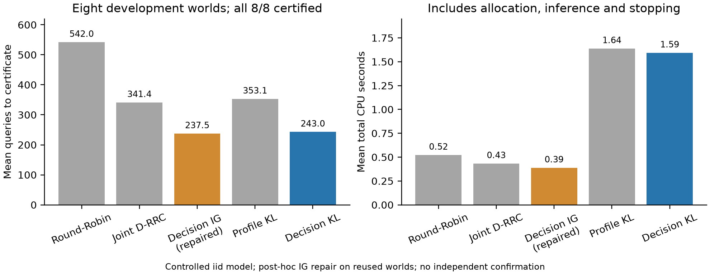

## Material Passport

- Origin Skill: academic-research-suite / experiment-agent
- Origin Mode: run + descriptive validation
- Origin Date: 2026-11-03
- Verification Status: ANALYZED; deterministic raw-response and policy-history replay checked separately
- Version Label: recommendation_loop_development_v1_with_IG_numerical_repair

# 推荐方法闭环：已跑通，但尚未超过最强基线

**结论：技术闭环可以继续，方法优越性仍需 REVISE。** 已实现“观察回答 → 联合估计 →
推荐导向选问 → 认证后推荐”的完整循环，并完成小规模受控开发试验。Decision KL
相对 Joint D-RRC 平均少用约 28.8% 的询问，但修复数值问题后的 Decision IG 平均
237.5 次，优于 Decision KL 的 243 次。不能把这一轮写成“我们的方法稳定超过强基线”。

这轮把之前输入真实参数、计算信息复杂度的理论程序接成了只接收公开商品信息和真实
观测回答的在线策略。它是一套程序化主动查询方法；没有使用 Qwen 对话 Agent。
原理论、论文草稿和历史实验未修改。本目录基于提交 `7207c63`，在独立工作树中开发。

## 已经接上的四个部分

1. **联合推断**：从回答估计偏好符号、各组最佳问法和两档正确率；不读取生成器真值。
   使用全数据连续联合 MLE，不能称作精确后验。没有识别出可靠性差距时，记录并使用
   均匀探索，不代入真实的 p、q。
2. **推荐导向分配**：针对能改变最佳商品的偏好翻转配置询问量；不再把恢复全部画像
   作为唯一分配目标。规划器使用固定精度的浮点连续 KL 优化，记录每次配置和失败。
3. **持续探索与追踪**：保留两种问法的稀疏强制探索，追踪累计目标分配，按统一周期更新。
4. **共同认证停止**：所有方法都只在最佳商品与其他商品的似然差通过区间认证后输出。
   不确定时继续，到上限则明确不认证。浮点筛查不能授权停止。

详见 [方法说明](METHOD_NOTE.md)、[预先冻结的方案](PROTOCOL.md)、
[认证规则与证明边界](GATE_NOTE.md)。

## 这次实际测了什么

采用受控的独立二元响应模型：真实 p=0.8、q=0.6，对策略均未知；不购买类型报告，
没有带标签校准样本。已知偏好组；商品效用是公开的偏好线性函数。不是成熟推荐数据集、
真实用户研究或自然语言可靠性发现实验。

两个事前固定的商品目录：一个 4 维两商品目录，一个 6 维三商品目录。每个目录有
全正偏好理论锚点和一个独立种子生成的画像，各用全共享、两组两种分组方式，共 8 个
环境。实际只有 **4 个画像簇**，同一画像跨分组复用；4 个环境是理论锚点。三商品目录
在整个偏好空间中三个商品都能获胜，但这次抽到的画像只覆盖商品 0 和 2。

风险参数 R=3，模型内任意时刻错误认证概率上界为 exp(-3)≈0.049787，并非恰好 0.05。
每条轨迹最多 2,000 次询问。所有方法使用相同的响应接口、成本和认证流程。同一环境
使用按动作索引配对的独立随机流；重复问同一动作仍获得新回答。

主试验预先冻结 5 个方法 × 8 个环境，共 40 条轨迹，15,019 个受控回答。另有单独
冻结的 IG 数值修复复核：8 条轨迹，1,900 个受控回答。两次各 10 条、每条 24 步的
smoke test 均保留，共 480 个回答；它们不计入效果表。所有阶段都没有 Qwen/API/GPU
调用或训练。没有挑选种子、替换失败环境或启动独立确认集。

## 最终比较

| 方法 | 平均认证询问数 | 每条平均总 CPU 秒 | 认证 / 尝试 |
|---|---:|---:|---:|
| Round-Robin | 542.00 | 0.522 | 8/8 |
| Joint D-RRC | 341.38 | 0.433 | 8/8 |
| **Decision IG，修复版** | **237.50** | **0.389** | 8/8 |
| 完整画像 KL 分配 | 353.12 | 1.639 | 8/8 |
| 推荐导向 Decision KL | 243.00 | 1.594 | 8/8 |

40 条原试验和 8 条修复轨迹全部认证，均无错误认证、截断、运行失败或诊断失败。
逐回答重放与终端区间证书复核均通过。观察到零错误不构成真实错误率的经验保证；
风险保证来自受控观测模型下的理论。



Decision KL 与 Joint D-RRC 对比：7 个环境更省、1 个更多，均值节省 98.375 次，
约 28.82%。与完整画像 KL 分配相比也是 7 胜 1 负，均值节省约 31.19%。后一个比较
共用估计器、追踪器和推荐停止条件，提供分配目标对齐的开发证据；它不是将两种
停止目标混在一起的比较。

**与修复版 Decision IG 相比，Decision KL 为 2 胜、0 平、6 负，平均多用 5.5 次，
约 2.32%。** 两个目录各自的均值也都略逊于 IG：4 维目录 156.25 对 153.00，
6 维目录 329.75 对 322.00。不能由微小均值差断言总体等效或任何方法显著更优。
KL 的规划计算也更贵；本样本平均总 CPU 约 1.594 秒，IG 约 0.389 秒。时间包含初始化，
受同机负载和缓存影响，只能作为这次执行记录，不能作通用性能承诺。

完整逐环境表见 [最终比较](results/FINAL_COMPARISON.md)，机器可读统计见
[final_comparison.json](results/final_comparison.json)。

## 必须保留的基线修复

原 IG 实现把差值小于绝对阈值 1e-14 的信息增益视作平局。当增益落到 1e-15 至
1e-25 量级时，不同动作因此可能被当成平局，退回按采样次数选择。原 40 条记录中
IG 的均值为 397.875；这个数不能继续作为已验证的强基线表现。

事后检查保留的 36 个前缀，不生成新回答：绝对平局与相对平局规则有 6 次动作差异；
相对规则下 Q6 和 Q14 的选择在这些前缀一致。此诊断不等于全局积分误差证明。
然后单独冻结修复，只将平局阈值改为 64×机器精度×最大增益的绝对值，不设绝对底线；
增益全零时才允许全平局。后验、Q6 积分、探索、停止、环境、随机流以及 Decision KL
全部保持原样，在同样 8 个环境上跑修正版 IG。

原 [结果](results/RESULTS.md)、原图、原代码及原始轨迹完整保留。修复是同一批开发
环境上的事后正确性复核，**不是新的独立测试**。本报告使用修复后的更强比较，并明确
承认原结论会高估 KL 相对 IG 的优势。见 [修复方案](REPAIR_PROTOCOL.md)、
[修复结果](results/ig_repair.json)、[积分前缀诊断](results/quadrature_replay_audit.json)。

## 对 WWW 论文现在能支持什么

可以支持：“推荐任务的查询目标可以从完整画像恢复，改为排除会改变推荐的替代状态；
我们实现了共享未知问法可靠性下的联合推断、推荐导向分配和严格停止。”本轮还提供
了对照完整画像分配的有限开发证据。

不能支持：“KL 策略优于最强推荐基线”“已证明这个实现渐近最优”“真实 Web 用户具有
相同共享可靠性结构”。R=3 的有限试验不是理论渐近系数的验证。数百次二元询问也
不证明该系统已适合真实的短对话推荐。与 Web 的联系在交互推荐的问题设定中，尚缺
真实商品、用户和问法有效性的外部证据。

下一阶段应先明确方法贡献的定位：认证推荐闭环已经成立，KL 特有的性能优势尚未
成立。若继续效果验证，应事前冻结修正版 IG、共同停止规则和更广的画像/目录设计，
在独立开发或确认样本上完整比较查询成本与规划成本。不能通过弱化 IG 或挑选胜出
环境来制造方法优势。本轮到此停止，没有启动下一轮采样或训练。

## 文件与复现

- [FREEZE.json](FREEZE.json)：主试验 14 个本地文件、3 个只读依赖与环境哈希。
- [REPAIR_FREEZE.json](REPAIR_FREEZE.json)：事后修复的独立冻结。
- [设计审计](DESIGN_AUDIT.md)：无结果前的初审、源码复查与修正；同模型家族辅助
  代理完成，不称为外部专家审查或跨模型独立验证。
- [CHECKS.json](CHECKS.json)：冻结、原文件保护、动作/回答重放、证书与 43 项测试回执。
- [RAW_MANIFEST.json](RAW_MANIFEST.json)：本地原始文件的路径、大小和 SHA-256。
  `artifacts/` 完整保留在本地，并由本目录 `.gitignore` 排除，不隐式发布。
- [验证报告](VALIDATION.md)：描述性统计限制和 11 类推断风险检查。

在仓库根目录执行单元与集成检查，不采集新回答：

```bash
OPENBLAS_NUM_THREADS=1 OMP_NUM_THREADS=1 python -B -m unittest discover \
  -s experiments/recommendation_loop_20261103 -p 'test_*.py' -v
```

当前机器有完整本地轨迹，可复核记录、动作和证书：

```bash
OPENBLAS_NUM_THREADS=1 OMP_NUM_THREADS=1 python -B \
  experiments/recommendation_loop_20261103/validate_results.py
```

实际依赖版本记录在 [CHECKS.json](CHECKS.json)。NumPy、SciPy、Matplotlib 可由仓库
`requirements.txt` 安装。正式重放应使用回执里的相同版本。

若希望重新生成全部 40+8 条受控轨迹，下面的入口只在指定的**新目录**复制最小依赖并
执行，不改当前冻结文件。原脚本遇到已有输出会拒绝覆盖。该命令尚未在本轮执行；
首次只验证复制步骤时可加 `--prepare-only`。完整运行最多 96,000 个廉价二元回答，
不涉及模型/API。它是确定性复现，不是独立确认。

```bash
OPENBLAS_NUM_THREADS=1 OMP_NUM_THREADS=1 python -B \
  experiments/recommendation_loop_20261103/reproduce_in_copy.py \
  --destination /tmp/recommendation_loop_reproduction
```

入口比较逐轨迹终端查询数和回答重放状态；时间不要求一致。修复冻结的生成时间/原始
结果哈希可能随重新执行改变，算法源文件和输入环境必须一致。完整复现辅助入口只验证
了源码、参数和零采样准备路径，未在本轮再次执行 48 条轨迹。
