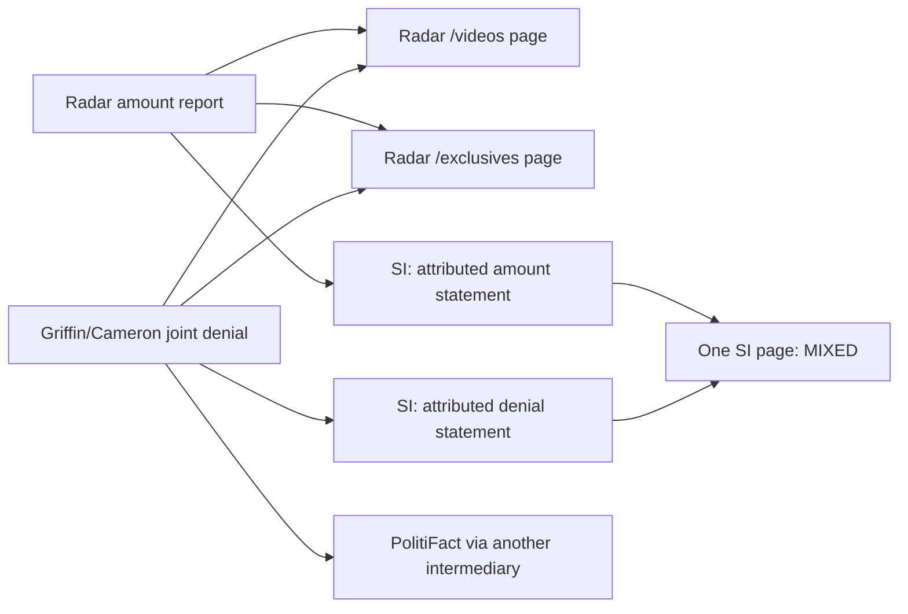

# Provenance: known material versus unknown independence

The complete typed graph is [provenance_graph.json](provenance_graph.json).
[provenance_edges.csv](provenance_edges.csv) lists edges, while
[dependency_pairs.csv](dependency_pairs.csv) covers all 104 pairs of distinct
nominated real URLs within the same claim. Four Metadata case rows are excluded.

There are 50 URL resources, 40 nominated document-identity groups, 26 observed
representations (24 body/interface representations, one metadata-only, one
header-only), 47 attributed statement records and 7 named material families.
**None of these counts is a count of statistically independent roots.**

Exact archive wrappers identify a nominated original address; they do not prove
that its historical and nonarchive versions have equal content. The two Radar
paths are explicitly evidenced as one article lineage. Login targets and
unverified www/non-www variants are not silently merged.

| Known relation view | What is justified | What remains unresolved |
|---|---|---|
| Tourism-study family | WISN attributed figure and PolitiFact synthesis name the same study series | Exact weekly release, extra input, independent measurement |
| Authorship publication | Factchecker links the primary publication | Total verdict evidence is not identical to one primary note |
| NSW case reports | News refers to public-health authority information | Same doctor office, same patient/event and independent reports |
| Debate utterance | Transcript is the linked original utterance | Speaker assertion is not publisher adoption or a new poll |
| Pew survey context | Reference names a specific poll | Primary poll uninspected; not a second independent root |
| Radar amount report | Two paths and SI attribution share reported material | Underlying court evidence and its accuracy |
| Joint denial | Same denial passes through several publishers/intermediaries | Independent truth of amount; no extra root per retelling |

The first five rows include named/common inputs, not interchangeable stochastic
reports. Only the two clearly shared-material families in the final rows justify
deduplicating retellings of those particular statements. A factchecker can also
use additional evidence; its entire page is not merged with its citation.

W1-11 shows why a page must have multiple provenance memberships:

Arrows in this small illustration mean observed transmission/attribution;
they are not a probabilistic DAG proof. The machine graph separately represents
URL identity, representation, statement membership and lineage edges.

Within-claim pair bookkeeping (mutually exclusive summary categories):

| Relationship summary | Pairs |
|---|---:|
| Same nominated document; version contents not equated | 11 |
| Known shared material or common named upstream | 8 |
| Explicit citation; no whole-page equivalence | 3 |
| Reported/unresolved source relation or target mismatch | 5 |
| No established relationship: UNKNOWN_DEPENDENCE | 77 |
| Total | 104 |

Every pair's statistical independence remains NOT_ESTABLISHED. Even pairs with
known dependence or identity have not been assigned empirical correlations.
Disconnected graph components are never promoted to independent roots. The
reported original-post copying relations in W1-04 and W1-06 remain secondhand,
because those post bodies were inaccessible.
