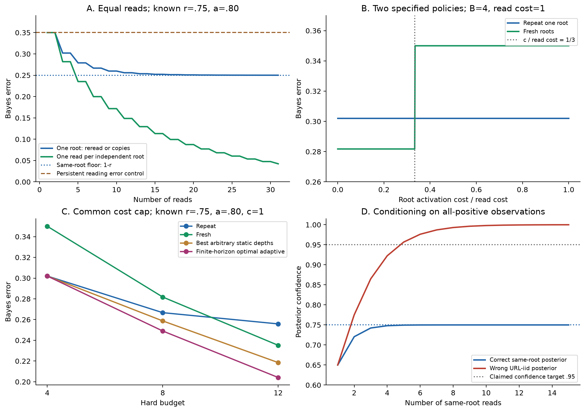

# W2a：无需人工签核的受控来源机制理论实验

**本轮已完成：自动真值构造、解析机制证明、有限预算计算、独立核验及可复现交付。** 这条受控实验线不依赖人工审阅。它支持“持久来源错误使重读与获取新证据产生不同价值，并存在稳定的自适应优势”的限定结论。

新增真实网页请求、Qwen/其他实验模型调用、训练、RL/SFT 和旧 Methodology 重跑均为 **0**。本报告的风险来自指定概率律的全枚举，不是模型回答准确率。原 W1/W1.1 共109个封存文件及两份 manifest 保持不变。

## 1. 交付与科学范围

| 部分 | 完成内容 | 能说明什么 |
|---|---|---|
| 自动真值语料 | 24虚构档案、192事实、768构造根、1,152模拟HTML | 语义、编辑及来源关系可由程序追踪 |
| 基础解析结果 | 同源复制等价、风险闭式、明确访问费翻转区间 | 指定通道内的机制区别 |
| 稳定自适应分离 | 一个冻结策略在正体积参数区域内胜全部静态分配 | 优势不是仅靠一个数值点 |
| 冻结数值网格 | 80观测律配置、81成本配置、30边界/依赖控制 | 精确状态计算与理论对应，保留无优势结果 |
| 独立核验 | 300个有理观测律；另有461项独立数值对照 | 数值与代码交叉核对，不等于人审或真实LLM验证 |
| 完整产物 | 代码、数据、证书、策略表、PNG/PDF图及哈希 | 无网络、无模型即可复算 |

两层实验的用途分开。HTML语料是 **Web结构启发的合成数据**，没有把未审阅的AVeriTeC事实当金标准，也不声称是从真实错误报道编辑而来的自然证据。数值实验另行定义原子根报告的概率通道，**没有从这1,152份HTML中实际抽取模型回答**。[语料说明](CORPUS_SPEC.md)

## 2. 模型、信息与成本

单个二元真值 θ 先验均匀；每个新构造根一次性产生持久报告 V，正确率为已知 r；每次读取该报告的正确率为已知 a，条件于 V 后相互独立。不同构造根的错误按机制独立生成，副本共享同一 V。根身份已声明，URL标签没有额外真值信息。

策略只见 r、a、成本、来源对应关系和此前读取结果，不见已实现的 θ、V 或评估结果。所有准确率基线均使用正确的共同概率模型与Bayes解码；URL独立假设的错误解码仅用于单列置信诊断。

激活一个根费用 c，每次读取费用 ℓ；副本在基准中不额外收费。这是受控成本定义，不是测得的网页访问价格。有限预算策略可以停止、获取新根或重读任意已读根，因此此处允许重访；不继承旧完成块类的最优系数或原未知可靠性理论。

## 3. 已证明的基本机制

令 x=2r−1、y=2a−1、t=(1+xy)/2，S_n(p)为n次二项观测多数票正确率，平票随机。

1. **同源重读与同源副本等价。** 相同通道和成本下，完整回答联合分布相同，不只是最终准确率相同。副本若增加非负打开费，重读可用不更多成本模拟它。该结论依赖相同读取通道和条件独立错误；不是对真实网页的经验发现。
2. **准确率上限。** 同根风险为 r−(2r−1)S_n(a)，极限为1−r；每次读一个独立根的风险为1−S_n(t)，可趋零。来源完全正确r=1时，两者的同读数观测律相同。
3. **三读严格差。** 相同三读下，新根相对同根的风险优势为 x(1−x²)y³/4。在r∈[2/3,5/6]、a∈[3/4,9/10]内，优势至少1/108，约0.926个百分点。
4. **成本会反转排序。** 固定硬预算B=4ℓ，比较“尽量重读一个根”与“每根只读一次”：0≤c/ℓ≤1/3时新根严格更好；1/3<c/ℓ≤1时重读严格更好。后一参数矩形内重读优势至少3/125。该阈值只比较两条指定策略，不是全局最优策略的普适门槛。

完整前提、推导和边界见 [THEORY_RESULTS.md](THEORY_RESULTS.md)。来源饱和及数据处理是已有机制与标准工具的应用；没有宣称这些工具是新的数学贡献。

## 4. 更强结果：自适应优势在一个非退化区域持续成立

比较对象为**全部预先确定的不同根深度分配**，包括不花完预算、事前随机化、任意终端随机化解码器；不只比较“全部重读”或“全部新根”。静态对手在每个参数点都能重新选择最佳分配和解码器。

中心r=3/4、a=4/5、c=ℓ=1、硬预算B=8时，独立Fraction证书为：

| 策略 | Bayes错误率 |
|---|---:|
| 重读一个根／零附加费同源副本 | 26.6672% |
| 每个新根读一次 | 28.1750% |
| 最佳共同固定深度 | 26.6672% |
| **最佳任意静态深度分配 (1,2,2)** | **25.8710%** |
| **有限预算最优动态策略 π₀** | **24.8990%** |

中心优势为243/25000，即 **0.972个百分点**。π₀的一种实现先开两个根，再根据观察是否一致决定重读还是获取第三个根；完整动作与停止由37个可达状态确定。其平均成本为6.3612，但比较约束是**每条轨迹不超过8的硬预算**，不是相同平均成本。

更进一步，冻结这同一个策略、停止规则及中心终端解码器，在整个区域

\[
r\in[3/4-1/4000,\;3/4+1/4000],\qquad
a\in[4/5-1/4000,\;4/5+1/4000],
\]
\[
c/\ell\in[4/5,1],\qquad B=8\ell
\]

中，它相对全部静态策略的错误率优势仍至少为

\[
\boxed{143/25000=0.00572\quad\text{（0.572个百分点）}.}
\]

证明分三步：此费用区间的可行菜单恰为“根数+读数≤8”；同一策略的参数扰动可由至多8个潜变量位的同步耦合控制；对所有静态策略取下确界仍有相同统一界。中心差减去两侧扰动界后仍严格为正。**整个区域由解析证明保证，角点或网格没有替代证明。** 中心常数由完整有限有理枚举认证，属于计算辅助的有限预算分离。[完整区域证明](ADAPTIVITY_REGION_PROOF.md)

这没有证明π₀在区域每一点仍最优，没有覆盖未知可靠性学习、未知来源图或任意渐近策略类，也未完成文献优先权审计。

## 5. 全部冻结数值结果与强基线修订

80个观测律配置完整保留：r∈{.6,.75,.9,1}，a∈{.6,.8,.95,1}，读数∈{1,3,5,9,15}。81个成本配置为r、a各三个水平，c∈{0,1,3}，B∈{4,8,12}，ℓ=1。[观测律CSV](law_grid.csv)、[全部成本CSV](cost_grid.csv)

- 同成本上，重读优于每次新根34个配置；新根优于重读38个；平局9个。访问费不能被忽略。
- 最优动态策略在 **15/81** 个配置严格优于最佳任意静态分配，其余 **66/81** 个为数值容差内无优势。动态类包含静态类，弱优是定义所保证，严格差才是机制见证。
- 网格最大静态差位于r=.9、a=.8、c=1、B=12：最佳静态(3,3,3)错误率8.8389515264%，动态为7.3186015232%，差1.5203500032个百分点。该点也有独立有理证书；它是开发网格结果，不是独立确认集。
- 中心小预算B≤6时，独立复核没有发现动态策略优于最优固定深度，负结果保留。

首次运行只比较共同固定深度。检查结果后增加了“全部静态异深度分配”这条更强基线，未改参数网格；初始代码与结果保存在 `initial_run/`，修订在 `AMENDMENTS.json` 中披露。例如中心优势因此由1.7682个百分点降为0.972个百分点。没有把较大的旧差继续作为“超过所有非自适应策略”的结果。

主网格采用float64全状态／计数枚举，没有Monte Carlo估计或采样显著性检验。独立实现使用未排序根状态与Fraction算术，对全部80个基础观测律及指定小预算、边界、两个优势见证作核对；**不是把81个DP配置全部独立重算了一遍**。461项对照最大差3.33×10⁻¹⁶。[独立审计](INDEPENDENT_REVIEW.md)

## 6. 置信度与依赖违例控制

同一根、r=.75、a=.8，读到5个同向结果时：

| 诊断 | 值 |
|---|---:|
| 正确来源模型的后验置信度 | 3073/4100 ≈ 74.9512% |
| 误把每个URL当独立根的后验置信度 | 371293/388100 ≈ 95.6694% |
| 真正条件错误概率 | 约25.0488% |
| 任一方向全同向事件的概率 | 41/125 = 32.8% |

此错误模型仍使用正确的单次边际正确率，因此隔离了依赖假设问题。固定读数下，两模型的分类符号同为多数票，**不能声称该诊断自动提高分类准确率**。真正失败的是置信与由其产生的保证。

若读取错误也根内持久，而不是每次独立，则同根风险始终为.35，不能下降到主模型的.25来源上限。这个控制拥有相同的一读边际却不同的重复依赖，说明不能仅测一次平均准确率就套用iid读取理论。[边界及依赖控制](boundary_and_dependency_controls.csv)

## 7. 自动真值与语料的边界

每档案8个虚构属性，4/4真值及选项顺序平衡。构造根按固定规则保留／翻转事实值，574根保留、194根翻转；未为提高算法效果重抽。每事实一个根有3份副本，另有3个独立构造根各1页。五类页面均保留，其中462份是单一断言方向，690份是引述、混合或未回答完整目标。

私有seed、真值、实际源报告与编辑账本留在 evaluator_only；策略接口只有任务、页面路径和声明来源身份。读取器看页面本身，不能让策略免费预读。独立DOM/可见语法解析重建陈述与标签，另行重算真值和源翻转；故意制造DOM／文本矛盾会被拒绝。保留seed重建的1,160个内容文件逐字节一致。

这说明受控构造可复现，无需人审；不说明自然网页独立、模型能够读取或4/4平衡的事实具有iid先验。本轮全概率计算的先验与语料平衡fixture分别定义，未混用。[构造核验](CORPUS_CHECKS.json)

## 8. 最终判断与论文使用范围

**GO：**这部分已形成“可核验构造—明确机制命题—稳定自适应分离—全量数值控制—独立证书”的闭环，适合支撑受控理论实验与WWW来源获取问题的机制论证。

**不能据此写：**发现自然网页错误率、测得Qwen读取可靠性／format gap、证明原未知可靠性方法胜出、给出真实根获取成本，或证明任意来源依赖图下的最优性。原Method确认实验、训练线与自然Web证据都没有被本轮替代。

如果论文采用本部分，建议主结果放“稳定的自适应—静态分离”及相同成本比较；同源复制、过度自信和持久读取错误作为机制控制。完整语义HTML只是自动构造与将来读取接口，不能作为1,152条真实模型实验展示。

## 9. 图与复现

图中A/B为解析曲线示意；C连接冻结的三个预算点；D条件于同向回答。均没有采样误差条。另有 [全部参数切片图](adaptive_gain_grid.png)，两图均提供PDF。

运行顺序、只读核验与全部文件索引见 [README.md](README.md)。最终内容哈希见 `MANIFEST.sha256`；原W1/W1.1的哈希回查位于 `FREEZE_RECEIPT.json`。
