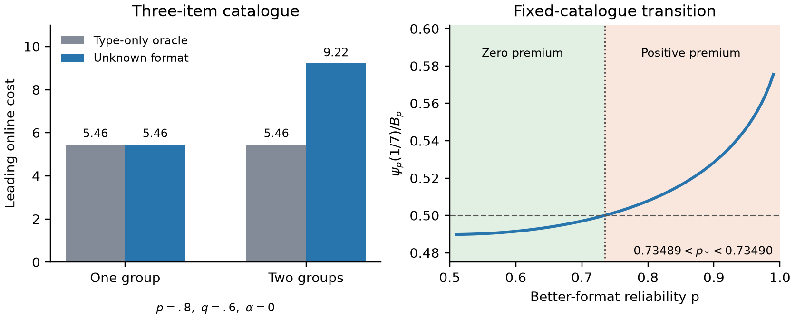

# 一般商品目录下，学习可靠问法何时需要额外成本？

日期：2026-11-03。**本轮第一项工作已完成：在无一阶校准信息的范围，得到了适用于一般目录的必要充分判据，并补上了此前未覆盖的结构结论。**

结论是相对原始理论及上一轮笔记的新增推导；文献优先权尚未认证，证明检查也不等于外部专家评审。工作保存在独立分支 `general_catalogue_theory_20261103`，没有改动已发布初稿。

## 1. 这次真正增强了什么

上一轮的完整闭式分界主要适用于两物品等权阈值目录；一般组证书定理还留下了一个范围未覆盖。这次把结论推进到一般有限目录，并解释了为什么无法简单套用最大组或最小组规则。

核心认识是：**不同商品的竞争关系，既决定要问哪些偏好，也决定可靠性学习能否被最优采样分配吸收。** 同样规模的共享组，不一定具有同样的作用。

以下 `K` 和 `K_or` 都是乘在 `log(1/delta)` 前的在线成本系数。零额外成本只表示 `K=K_or`，不表示完全不用学习问法。Oracle 仍然只知道最佳问法，不知道偏好或准确率。

## 2. 一般目录的精确判据

我们将所有候选准确率的连续最小化消去，得到只依赖偏好采样权重、组内翻转比例和二元熵的有限凸可行性判据。

对任意有限目录，它给出“零额外成本”与“严格正额外成本”的必要充分条件。它仍需要完整的最小决策翻转集，不是一个简单的组规模公式，也不意味着一般目录可以在多项式时间内求解。

固定采样权重后，只需将各组的翻转比例排序并检查前缀切割，避免枚举全部组互换。排序是已有数学工具；本轮贡献是它在未知共享问法模型中给出的成本边界。

一个附带结论是：在本轮的零一阶校准范围，零/正额外成本的边界不依赖另一问法的真实准确率 `q`，但正额外成本的大小仍可能依赖 `q`。判据仍依赖真实 `p`，用于理论复杂度分析；它还不是一个可直接运行的未知参数在线策略。

## 3. 一个更有解释力的结构定理

在此前未解决的 `rho<1/2` 范围，我们证明：若某个零额外成本分配使用了 `L` 个共享组，那么

\[
L-1\le\dim(\text{该分配所在的 oracle 最优面}).
\]

直观上，**同时利用多个组而不付一阶代价，需要 oracle 最优分配本身有足够的选择余地。**

特别地，当 oracle 的偏好采样比例唯一时：

\[
K=K_{\rm or}
\iff
\text{该比例中所有正权重偏好都在同一个共享组。}
\]

这适用于一般目录，而非仅适用于多数决。反过来，存在一些目录，零额外成本必须通过多个 oracle 最优分配的内部混合来实现；任取一个 oracle 最优顶点并不够。这给后续方法一个具体问题：不仅要找到最优采样比例，还要在多个最优解中选择与可靠性共享兼容的那个。

## 4. 已有真正的三商品例子

我们构造了六项偏好、三个商品的非等权目录。完整枚举全部 64 个用户状态：

- 没有推荐平局。
- 三个商品分别在 20、21、23 个状态下胜出。
- 六项偏好都能影响推荐。
- 两个竞争商品都贡献必要的替代解释。
- 最小翻转集合同时包含两项与三项偏好，不能化成旧的等权阈值例子。

在全正偏好状态，证明 oracle 的采样比例唯一，为

\[
(3,2,2,1,1,4)/13.
\]

因此六项偏好全部在一组时零额外成本，任何非平凡划分都产生严格正的额外成本。`p=.8,q=.6` 时连续信息规划的数值核对为：

| 共享结构 | 未知问法成本系数 | 只知问法的 oracle |
|---|---:|---:|
| 六项同组 | 5.46066 | 5.46066 |
| 前三项、后三项分组 | 9.21965 | 5.46066 |

这些是渐近理论系数的浮点诊断，**不是我们的方法比基线节省了多少次提问**。严格零/正结论来自证明及精确有理数证书。

该目录所有状态下的最小赢家间隔为 1。每件商品的截距与属性参数的绝对扰动总和小于 `1/2` 时，全部赢家保持不变，因而结论在明确的开放邻域成立。这种稳定性保留了决策映射，不能单独当作解决一般加权目录问题。

## 5. 同一目录还会出现准确率临界点

另一个构造固定用户状态、两组各七项偏好和十件商品。我们证明，是否产生额外成本随真实 `p` 改变，并有唯一临界点：

\[
0.73489<p_*<0.73490.
\]

这一区间由精确有理数对数包络认证；小数近似为 `0.734893622116569`。

例如固定 `q=.55,eta=.01`：

| 真实 p 区间 | 一阶额外成本 |
|---|---|
| [0.6,0.7] | 零 |
| [0.8,0.9] | 严格为正 |

所以一般目录不存在完全不依赖准确率的分组规模判据。这说的是相对同率 oracle 的代价，不表示准确率提高会增加绝对提问成本，也没有给出上述整个正区间的显式统一成本比下界。



## 6. 被反例排除的简化

本轮保留了三条负面结果：

1. 只检查全局最难区分的翻转集不充分。原本有余量的替代推荐，在组类型互换后可以成为瓶颈。
2. 把每组单独计算的分数证书值汇总起来，仍不足以判断一般目录是否零额外成本。
3. 不能假设未知问法的最优策略只使用可靠格式。这个性质仅在与 oracle 成本相等时由证明强制成立；正成本差实例的最优解可能使用两种格式，程序保留了全部动作。

## 7. 验证、范围与论文价值

验证包括三个明确目录合计 112 个不同状态的枚举；120 个熵消元/原始内层程序比较，其中 24 个另用独立连续最小化核对；另一个独立实现检查了 300 个排序切割夹具。六个完整连续信息规划实例通过，五个准确率点获得了精确符号包络，包括临界点两侧。

同系列辅助推导与候选证明审查分开记录，最终整合审查为非盲检查。它们不能替代外部数学专家复核或文献新颖性认证。浮点优化结果一直标为诊断。

本轮假设仍然是固定偏好、已知分组、共同未知对称准确率和独立新鲜回答，且只处理 `alpha=0`。一般目录的正一阶校准扩展仍未完成；直接类型自报、持续性错误、真实用户以及 Qwen 的共享可靠性均未由这项工作验证。

就论文而言，理论主线已经可以从“共享组有多大”，推进为：**商品竞争关系怎样约束最优证据分配，而这种约束又怎样决定学习可靠问法的代价。** 这比给原始完整画像问题换推荐术语更直接。下一项方法工作应围绕兼容共享结构的信息分配和推荐级停止展开，尚未在本轮执行。

## 文件与复现

- [统一定理及证明](GENERAL_THEOREM.md)
- [目录、精确对偶证书和三商品证明](CATALOGUE_EXAMPLES.md)
- [一般判据的推导及最优面结论](UNSATURATED_DERIVATION.md)
- [反例、准确率转变及排序证明](ADVERSARIAL_GEOMETRY.md)
- [文献归属与核查范围](LITERATURE_BOUNDARY.md)
- [数值记录](results.json)、[精确证书](exact_certificates.json)、[复现与保护记录](CHECKS.json)

在仓库根目录运行（依赖 NumPy、SciPy、Matplotlib；历史内层求解器按提交保存并导入）：

```bash
python research/general_catalogue_theory_20261103/validate_general.py
python research/general_catalogue_theory_20261103/geometry_counterexample.py
python research/general_catalogue_theory_20261103/catalogue_examples_search.py
python research/general_catalogue_theory_20261103/plot_general.py
```

三个补充推导文件各自保留了独立或候选知情推导的范围与出处；统一论述以 `GENERAL_THEOREM.md` 为准。没有新增模型调用、训练、线上 Agent 轨迹或远程发布。
