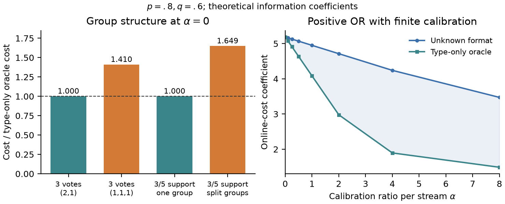

# 从完整画像到最优推荐：本轮理论探索结果

日期：2026-11-03。**判断：GO，值得沿这条理论继续；尚未达到真实推荐方法已验证或论文创新性已认证的状态。**

本轮得到了原始《Theory Note》中没有的推荐决策判据。关键变化是：**可靠性学习的额外成本，不仅取决于偏好如何共享问法，还取决于哪些偏好改变会真正改变推荐。**

工作在新分支 `top1_decision_theory_20261103`。已发布的四页论文、原始理论和历史实验没有改动；没有新增 Qwen 调用、训练或线上 Agent 实验。

## 1. 原问题与新问题

原理论要求恢复整个二元偏好向量。新问题给定一个商品目录及效用函数，只要求以同样的错误上限选出最优物品。所有偏好、问法、准确率、共享组和校准条件保持原定义；oracle 仍然只知道最佳问法，不知道准确率。

“只需要正确决策，不必识别全部参数”是已有研究的重要思想，不能作为我们首次提出的贡献。这次真正新增的候选结果，是这种目标变化如何改写**共享可靠性的成本边界**。与已有纯探索、传导式推荐和证书复杂度的对照见 [文献与创新边界](LITERATURE_AND_NOVELTY.md)。

## 2. 一个比原稿更直接的推荐故事

考虑两件候选商品。一件相对另一件的效用随用户满足的需求数增加；满足至少三项需求时它更好，否则另一件更好。这里有五项二元需求，因而可以把它理解为五维偏好的多数决推荐。

当五项需求都支持第一件商品时，需要至少改变三项偏好才会翻转最优推荐。在没有一阶校准信息时，我们证明：

- 若有四项需求共享可靠问法，另一项独立，学习问法不增加一阶成本。
- 若需求分成三项与两项两个共享组，则仍有严格正的额外成本。

两种情况都不是所有偏好共用同一个组，前一种甚至含有一个单独的偏好。这说明原来的“最小组”规律不能原封不动搬到推荐任务。五项偏好都与这个目录全局相关，例子不是给一比特问题附加几个无用维度。

## 3. 已完成的两个主要定理

设支持当前最优物品的偏好有 `n` 项，需要其中至少 `tau` 项支持才能维持它胜出。改变推荐至少要翻转

\[
r=n-\tau+1
\]

项支持偏好；第 `g` 个共享组包含其中 `k_g` 项。

**定理一：无一阶校准信息时，最大的支持组决定零额外成本。**

\[
K=K_{\rm or}
\quad\Longleftrightarrow\quad
\max_g k_g\ge\min\{n,\max\{1,2(\tau-1)\}\}.
\]

它覆盖两种状态：接近推荐边界时，全部关键支持偏好需要在一个组内；离边界较远时，只需一个足够大的支持组。当全部坐标都是支持项且 `r=1` 时，才完整恢复原来的全画像信息问题。

**定理二：有正的一阶校准信息时，只检查支持当前推荐的组，并纳入所需的同时翻转数。**

记 `k_min^+` 为非空支持组的最小规模，则

\[
K=K_{\rm or}
\quad\Longleftrightarrow\quad
k_{\min}^{+}>r\ \text{且}\ \Gamma_{k_{\min}^{+},r}\ge1.
\]

这里的 `Gamma` 和 oracle 成本都有明确的标量表达式，可以直接计算。它不等于原定理中对所有偏好组计算的最小组判据。完整假设、公式和证明见 [THEORY_RESULTS.md](THEORY_RESULTS.md)，另有 [阈值推导及有限校准审查](THRESHOLD_AUDIT.md)。

补充结果将零校准的 oracle 成本接到已有的分数证书复杂度上，并给出一个组内证书判据。我们保留证书概念的已有归属；候选贡献是它与未知共享问法之间的精确关系。

## 4. 数值核对结果

以下前四行固定 `p=.8,q=.6,alpha=0`。数值是乘在 `log(1/delta)` 前的期望在线成本系数，**不是实际提问次数或推荐准确率**。

| 推荐实例 | 分组或支持位置 | 未知问法 | 只知问法的 oracle |
|---|---|---:|---:|
| 五项全部支持，多数决 | (4,1) | 5.18821 | 5.18821 |
| 五项全部支持，多数决 | (3,2) | 5.73021 | 5.18821 |
| 五项中三项支持，多数决 | 固定(3,2)分组，支持项都在三项组 | 5.79343 | 5.79343 |
| 五项中三项支持，多数决 | 同样分组，支持项分散为(2,1) | 9.55361 | 5.79343 |

后两行保持同一目录与同一组划分，仅改变用户偏好。可靠性学习是否产生额外成本随用户状态改变。

另有两个正校准实例通过了新判据：保留一个不参与当前决策的单项组时，原始最小组仍为 1，但决策级别可以达到 oracle。程序没有事先删除这些可查询坐标。

对于三项多数决、三项都支持、三个单项组的实例，除浮点求解外，还给出了**精确有理数对数包络证书**：未知问法成本严格超过 oracle 的 **1.23 倍**。这是一条关于成本溢价的下界，不是方法比基线提升 23%。



图右是正 OR 推荐的特殊现象：`alpha=0` 时无额外成本，而任意固定 `alpha>0` 都有正溢价；两方的在线成本仍然下降。不能把这解释为校准让任务更难。

## 5. 对 methodology 的直接启发

停止条件应该检查“同一置信标准下仍需保留的解释是否同意同一个最优物品”，而不是检查“是否只剩唯一偏好画像”。我们写出了联合未知率下的决策 GLR，并证明相同采样路径上它不晚于完整画像 GLR 停止。

一个精确历史夹具展示了严格差别：三维 OR 推荐中，只查询一维并连续获得 20 个正回答，其余两维完全未问；在指定的 `eta=.05,delta=.01` 下，决策停止条件已经成立，而完整画像的似然间隔仍为零。这是可能历史的数学例子，不是一次新模型实验。

**后续比较必须给所有基线相同的 top-1 目标与决策停止机会。** 把我们的推荐停止与被迫恢复全部画像的基线比较，不能证明超越强推荐基线。本轮尚未完成这样的公平方法比较。

还有一个被排除的机制：在当前同费用、共同可靠率的对称模型下，完全不出现在最小决策翻转集中的偏好，不能作为特殊校准探针严格降低最优一阶成本。它们可以出现在非唯一最优分配中，但不是取得该成本所必需的动作。

## 6. 可靠性、非退化性与验证范围

这些结论保留了原模型的强假设：固定偏好、已知有效分组、共同未知准确率、新鲜独立回答和有标签参考流；本轮结构定理不包含直接类型自报动作。真实用户或 Qwen 是否具有这些性质，仍未得到验证。

阈值目录也不是一个孤立的等权参数点。只要商品效用参数相对基准的总扰动小于 1，整个二元偏好空间中的最优物品都保持不变，定理随之保持成立。这是一个明确的开放参数区域。它不把 `alpha=0` 结论扩展到正校准区间。

本轮完成：

- 258 个偏好/阈值组合的完整决策替代集检查。
- 36 次独立连续最小化，核对内层闭式投影。
- 12 个连续信息规划实例及 8 个校准量点的核对。
- 一个严格成本差的有理数包络证书，以及一个精确停止历史夹具。
- 分开任务的推导检查；有限校准部分及最终整合检查是在提供候选结论/证明思路后的非盲审查。它们不是外部专家评审或跨模型家族认证。

## 7. 下一版文章怎样组织

主线可以改为：**推荐决策需要的证据，与完整用户画像需要的证据不同；学习怎样可靠地问，又会如何改变这笔成本？**

原理论成为基础。新主贡献用阈值目录的零/正额外成本边界承接推荐目标；决策证书解释这个边界，决策 GLR 给出方法上的直接落点。通用纯探索工具与证书概念保留已有文献归属。

这比当前初稿的“把完整恢复映射为可分列表推荐”更接近推荐决策本身。下一步最值得做的是扩展最近邻核查、由合作者逐条复核证明，再据此重写初稿；不必先启动模型训练。一般多物品目录的闭式共享条件、直接自报接口和真实环境有效性仍未解决。

## 复现

在本目录安装 NumPy、SciPy、Matplotlib 后运行：

```bash
python validate_results.py
python plot_results.py
```

结果位于 [numerical_results.json](numerical_results.json) 和
[exact_certificates.json](exact_certificates.json)。浮点信息规划结果始终标为数值诊断；严格下界使用独立的有理数包络。原始理论与文件校验信息见 [CHECKS.json](CHECKS.json)。
