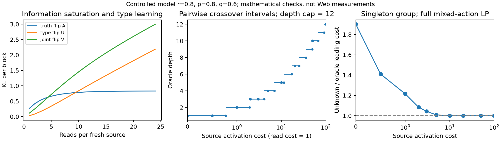

# 来源成本与可靠性共享：本轮理论结果

日期：2026-10-31。

**结论：受限模型的理论推进 GO；作为论文核心创新仍需 REVISE。** 本轮完成了一个有匹配下界和可达性的充要条件，说明来源访问成本如何通过最优读取深度，改变消除未知提问形式一阶成本所需的最小共享组。它比上一轮的“双重极限下相对成本趋于 1”更具体，但仍没有恢复原理论的未知连续可靠率与有限校准条件。

完整推导见 [THEORY_RESULTS.md](THEORY_RESULTS.md)，独立复核见 [FINITE_STATE_PROOF_AUDIT.md](FINITE_STATE_PROOF_AUDIT.md) 与 [ADVERSARIAL_AUDIT.md](ADVERSARIAL_AUDIT.md)。本轮采用 academic-research-suite 的理论研究与反例审查流程；协作者共享上下文、使用同一模型家族，不是盲审、跨模型验证或形式化证明。

## 1. 研究问题已经从 Web 场景描述变成可判定的数学问题

考虑核验多个事实。打开一个新来源要付访问成本 c；对同一来源每次读取要付成本 ell。来源可能一直陈述错误事实，反复读取不能消除这种来源错误。两种读取形式有不同抽取可靠性，一个组中的多个事实共享更可靠的形式。

问题是：**高昂的来源访问成本，是否让策略在有效读取事实的同时，获得足够的形式可靠性信息，从而降低跨事实共享的需求？**

本轮保留持续性来源错误、未知共享形式、独立新来源和访问成本，但固定以下限制：

- 来源可靠率 r、优劣形式可靠率 p,q 已知，只有事实 θ 和共享形式 z 未知。
- 每个新来源只服务一个事实；不存在一次访问同时获得多个事实的成本共享。
- 每次预先决定在新来源上读多少次 A、多少次 B，完成后放弃该来源。读取总数有固定上限。
- 所有混合和均衡读取方案都可以选择；允许跨块自适应。
- 不允许块内调整、提前停止或重访旧来源；没有额外类型询问或离线校准。

这是明确缩小问题以获得完整定理，不能直接替代原来的未知可靠率理论。

## 2. 已完成的主要结果

令 A_L 是同一可靠形式下区分事实真假的 KL 信息，U_L 是保持事实不变而交换形式的 KL 信息，V_L 是同时交换形式与事实的 KL 信息。所有量都按包含持续性来源错误的完整块分布计算。

已证明：

1. **事实信息饱和，而形式信息可以继续增长。** A_L 随深度增加但趋于有限上限 κ(r)；U_L 趋于无穷，且 V_L≥U_L。二者不矛盾，因为它们比较的替代假设不同。
2. **oracle 的完整最优分配得到刻画。** 其只使用纯优形式块，最优深度集合为 M(c)=argmax_L A_L/(c+ell L)。混合块虽被允许，但对已知形式的 oracle 严格劣于同深度纯优形式块。
3. **未知形式的最优一阶成本有下界及匹配可达策略。** 给出了有限状态信息规划、正确率统一保证、可求和的停止尾界及实际成本换算，证明的是期望总成本，而非仅几乎处处停止。
4. **得到成本相关的最小共享组充要条件：**

\[
\boxed{
\text{未知形式与 oracle 的一阶成本相同}
\iff
\max_{L\in M(c)}
\frac{V_L+(k_{\min}-1)U_L}{A_L}\ge1 .
}
\]

“一阶成本相同”指两者在 δ→0 时，期望成本的 log(1/δ) 系数相同，不是有限预算准确率相同或额外成本绝对消失。

这个条件检查了所有错误事实替代，包括同时修改多个组的类型与事实。最优深度并列时，必须检查整个最优集合；任意挑一个最优深度可能得出错误结论。

## 3. 一组可复现的数学示例

固定 r=.8、p=.8、q=.6，每次读取成本为 1，深度上限为 12。下表的成本比来自包含所有混合读取动作和全部错误事实替代的线性规划；共享组门槛来自已证公式。

| 来源访问成本 c | oracle 读取深度 | 零一阶额外成本所需最小组大小 | 单事实组：未知形式 / oracle 成本系数 |
|---:|---:|---:|---:|
| 0 | 1 | 7 | 1.9003 |
| 1 | 2 | 3 | 1.2149 |
| 2 | 3 | 2 | 1.0834 |
| 5 | 4 | 2 | 1.0080 |
| 10 | 5 | 1 | 1.0000 |
| 20 | 7 | 1 | 1.0000 |

这些是规定模型中的说明性计算，不是 Web 数据、Qwen 实验、场景筛选后的性能结果，也不是有限 δ 下的实测成本。

并列最优的检查尤其有用：把上限固定为 2，在 c≈.774068 的交点，深度 1 和 2 对 oracle 同样优；对于大小为 3 的组，前者不满足判据，后者满足。因此“选定一个 oracle 最优解再检查”的简化不成立。

## 4. 保留下来的负面结论与反例

**提高来源成本不能自动消除额外成本。** 若预先固定的深度上限仍不满足判据，成本再高也会保留严格大于 1 的渐近成本比。深度上限为 1 的例子就是如此。相反，对每个固定 r<1、p>q，确实存在足够大的有限深度上限与有限访问成本，使单事实组也达到零一阶额外成本。这两个结论的量词不同，已经分别证明。

**信息比值不总随深度或成本上升。** 取 r=17/20、p=39/40、q=487/500、深度上限 3：

- 访问成本 15 时，oracle 唯一最优深度为 2，单事实 Γ≈.9998588452；
- 访问成本 25 时，oracle 唯一最优深度为 3，单事实 Γ≈.9998397115。

Γ 反而下降。这个反例有精确有理数区间认证，排除了浮点舍入造成假象。它否定 Γ 的普遍单调性；没有证明整数共享门槛非单调，也没有否定零额外成本判定的单调性。这两个问题仍保留为未解决。

**已知可靠率是实质性假设。** 若 p,q 未知，替代模型可以同时调整它们，原来的固定通道 U_L、V_L 不再描述最难替代。尤其只查询优形式时，替代模型可能将未知的劣形式可靠率设置为真实 p，再调整未观测的优形式可靠率。不能把本轮公式原样搬回原理论。

## 5. 另一项交付：有限置信度的明确上界

上一轮的均衡读取策略已整理成有限 c、有限 δ 的成本比上界：

\[
\frac{C_u}{C_o}\le
\frac{\kappa(r)}{\overline D_k}
\left(1+\frac{2k\ell}{c}\right)
\frac{\log(1/\delta)+\operatorname{logit}(r)}
{\operatorname{kl}(1-\delta,\delta)}.
\]

此处每个新来源分别读取 k 次 A、k 次 B，保留总正回答数；其分布不依赖未知的优形式。它适用于单事实、c>0，且在固定菜单内需要 2k 不超过深度上限。由于使用通用 oracle 下界，它也能比较允许重访的较大策略类，但只是上界，不能宣称该均衡策略最优。

例如 r=.8,p=.8,q=.6、k=16、c=1000、ell=1：

- δ=.01 时，上界约为 1.4076；
- δ=10^-6 时，上界约为 1.1641。

这也显示：渐近“无一阶额外成本”不等于普通置信度下的差距已经很小。

## 6. 新颖性与 WWW 定位

检索并实质比较了 8 篇主要来源，另保留 1 个全文访问未解决的近邻；详见 [FOCUSED_NOVELTY_AUDIT.md](FOCUSED_NOVELTY_AUDIT.md)。

通用的单位成本信息优化已经有明确先例，例如 [Vershinin 等的 cost-aware sequential testing](https://arxiv.org/html/2512.19067v3)。来源错误与抽取错误分层也已有 [Knowledge-Based Trust](https://www.vldb.org/pvldb/vol8/p938-dong.pdf) 等 Web 工作。近期 [Ham 等的 human–AI testing](https://arxiv.org/html/2609.28859v1) 还研究了付费获取潜在标签项目、噪声 AI 与人工核验。

因此论文的候选贡献应表述为：**刻画持续性来源错误和访问成本怎样改变未知查询形式的共享需求，并给出必要且充分的条件。** 泛泛的“给 Web Agent 加入可靠性、成本与信息增益”不足以构成理论新颖性。

已阅读来源中未找到相同的完整充要条件，但本轮定向检索不证明首创性。目前适合作为原理论的结构扩展；暂不适合作为已经完成的 Web 一般最优性理论，也不足以单独判断论文可投。

## 7. 复核规模和边界

| 检查 | 数量 / 状态 |
|---|---:|
| 精确有理数：块分布与计数充分性 | 112 项通过 |
| 80 位 Decimal 信息量计算 | 240 行 |
| 包含全部替代与混合动作的完整 LP | 95 个实例通过 |
| 同深度混合块严格支配检查 | 108 项通过 |
| Γ 非单调反例 | 精确有理区间认证通过 |
| 期望成本与停止论证 | 完整书面证明并经另一协作者复核 |

Decimal 与 LP 数值检查不是形式化证明。精确区间认证只针对明确列出的反例和对应 oracle 深度。未进行模型调用、训练、随机 benchmark 世界生成或确认实验；上一轮理论快照及原理论输入均保留。

## 8. 下一步建议

**优先恢复未知 p,q 和有限校准，暂时保留固定来源块。** 这一步直接连接原 Theorem 1–3 与本轮的 Web 扩展，能够检验这里的机制是否依赖“提前知道可靠率”。建议交付顺序：

1. 写清两层 likelihood 和替代参数域。校准的是来源可靠率还是报告抽取可靠率，必须分别定义；校准成本是否计入目标也要固定。
2. 建立含校准项的联合 KL 下界。先检查 oracle 最优分配是否仍有可用结构，再判断能否压缩成共享门槛。
3. 若原式不成立，保留反例并找正确的变分条件；不为了复用本轮公式限制替代模型。
4. 仅在这个连接完成后，再开放来源重访、块内自适应或多事实共享访问。否则同时改变多个关键假设，会难以判断哪项机制贡献了结果。

本轮已经有可审查的限定结论。下一阶段的成败标准，是恢复未知可靠率后仍得到明确可证的条件，或得到说明本轮机制边界的反例。
