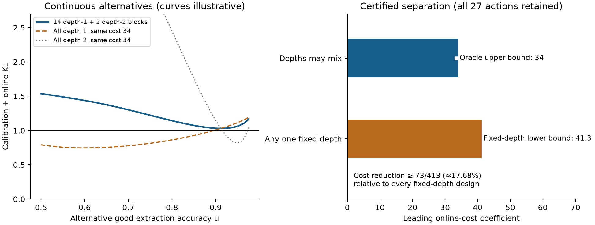

# 未知可靠率下 oracle 的提问形式与读取深度

本轮已经严格解决一个关键问题：**一般多读模型中，最优 oracle 不能总是简化为单一读取深度。** 即使它知道最佳提问形式，仍可能必须兼顾“访问更多独立来源”和“对同一来源重复读取”。同时，我们证明了两个纯优格式边界、一个一般校准资源比较，并完整恢复了 α=0 时“单组／多组”的共享分界。有限正校准、两种格式均有效时，是否始终只需优格式，仍然开放。

所有结果保持上一阶段的模型：来源正确率 r 已知；提取正确率 p、q 未知；每个来源块事先决定读取组成；来源报告在块内固定；有两路有限校准数据；oracle 只知道最佳形式；比较渐近期望在线成本。没有改变历史理论、运行 Qwen、训练模型或启动确认实验。

## 1. 已认证的核心结果

构造一个只有一个事实的实例：

\[
r=0.6,\quad p=0.95,\quad q=0.6,\quad
\alpha=1,\quad c=\ell=1,\quad L_{\max}=6,\quad\eta=0.025.
\]

允许深度 1 至 6 的所有 27 种格式组成。固定深度基线可以在该深度内任意混用格式，比较范围没有被削弱。

| 比较对象 | 渐近在线成本系数的认证结果 |
| --- | --- |
| 完整 oracle，可混合深度与格式 | 32.947798… ≤ K_or ≤ 34 |
| 固定深度 1，允许所有格式混合 | 至少 48.52325… |
| 固定深度 2 至 6 中任意一种，允许所有格式混合 | 每一种都至少 41.3 |
| 同一实例中另外揭示 p、q 的 oracle | 约 30.527934；唯一最佳动作是优格式、深度 1 |

上界 34 来自每单位 log(1/δ) 配置 14 个优格式单读来源块、2 个优格式双读来源块。这里的 14 和 2 是渐近分配系数，不能解释成固定做 16 次试验就满足任意错误率。

因为 34 < 41.3，**未知可靠率下，每一个完整 oracle 最优分配都必须包含至少两个深度**。允许混合深度相对任何固定深度，成本系数至少减少 73/413，约 **17.68%**。这不是精确最优值、有限预算实测提升，也不是自然 Web 用户行为的结论。

认证覆盖连续区域 1/2 ≤ v ≤ u ≤ 39/40。校准的弱通道可精确剖面化为 v=min(q,u)，随后用 950 个有理区间、严格对数区间和二阶 Taylor 余项覆盖所有 u。最小信息余量仍超过 0.02857。下界对每个固定深度的全部格式组成逐一检查。另一个审计任务独立阅读了证明与证书代码，结论为通过；它不是形式化证明或独立模型交叉验证。

详见 [完整命题与证明](DEPTH_MIXING_THEOREM.md)、[结构化证书](DEPTH_MIXING_CERTIFICATE.json) 和 [独立审计](DEPTH_STRUCTURE_AUDIT.md)。

## 2. 纯优格式已经证明到哪里

| 条件 | 本轮结论 |
| --- | --- |
| α=0，允许任意 q≥1/2 | 每个 oracle 最优分配都只用优格式；可能混合深度 |
| q=1/2，允许任意有限 α≥0 | 每个 oracle 最优分配都只用优格式；可能混合深度 |
| α>0 且 q>1/2 | 一般纯优格式最优性尚未证明，也没有认证反例 |

关键证明使用真正的共同随机映射：令 κ=(2q−1)/(2p−1)，将优格式输出再通过保留信号比例 κ 的二元噪声通道，可同时把真实 p 映到 q、把备选 u 映到 v(u)=1/2+κ(u−1/2)。α=0 时该备选路径没有校准惩罚差；q=1/2 时它恰好是校准最不利的弱通道。严格数据处理和紧致性随后排除所有含弱格式的最优分配。

对一般正校准，仍可给出一个有条件资源比较。记 K_pure(α) 为只准优格式但允许全部深度的 oracle 系数，K_full(α) 为完整 oracle 系数，则

\[
K_{\rm pure}((1+\kappa^2)\alpha)
\le K_{\rm full}(\alpha)
\le K_{\rm pure}(\alpha).
\]

左边允许更多校准，不能改写成同一校准预算下纯优格式最优。它说明增加不到一倍的校准信息，足以补偿这条比较中可能存在的弱格式作用；比较仍只计在线成本。缩放因子依赖真实参数，这是系数之间的点态关系，不是已实现的未知参数校准分配策略。

我们还认证否定了一个看似合理的证明引理：即使真实提取率逐坐标都高于备选率，提高某个真实坐标的可靠率，也不保证相关 KL 总和单调增加。这排除了一条错误证明路线；它不否定完整纯优格式命题。完整推导和边界见 [格式结构审计](ORACLE_STRUCTURE_AUDIT.md)。

## 3. 共享条件可以怎样继续简化

**α=0 时，可以得到不依赖唯一性的一般结论：** 在固定有限多读菜单下，未知格式的学习者与格式已知的 oracle 具有相同一阶成本，当且仅当所有事实属于一个共享组：

\[
\alpha=0:\qquad K_{\rm learner}=K_{\rm oracle}
\quad\Longleftrightarrow\quad G=1.
\]

G>1 时，一阶系数有严格正差。这允许任意深度混合、任意组大小，也不要求 oracle 最优解唯一。证明使用上面的“所有最优解纯优”定理：每个最优解存在一条紧约束，其最不利提取率严格小于 p；只翻转该事实所在组的类型后，组外用于辨认提取率的信息消失，便破坏该最优解的可行性。单组时，整体翻转类型只是把一个未知在线准确率换成另一个，而 oracle 的备选参数已覆盖该区间。完整证明见 [深度与共享审计第 9 节](DEPTH_STRUCTURE_AUDIT.md)。

这是固定 d、固定菜单、α=0 的系数结论，不是 α>0 的一般定理，也不处理 d 随错误率共同增长的极限。

**对于一般有限校准，当前得到的是以下精确约束和条件性化简。**

在任意一个纯优格式 oracle 最优分配上，本轮证明了精确的组内检查。若组 g 内各事实的深度分配相同，记为 b_(g,L)，令

\[
H_L(v)=D(P_{p,L}^{+}\Vert P_{v,L}^{+}),\qquad
J_L(v)=D(P_{p,L}^{+}\Vert P_{v,L}^{-}),
\]

则额外的未知类型约束归约为

\[
\Gamma_{k_g}(b_g;\alpha)
=\inf_{1/2\le v\le p}\left[
\alpha\operatorname{kl}(q,v)+
\sum_L b_{g,L}\{J_L(v)+(k_g-1)H_L(v)\}\right]\ge1.
\]

这保留了完整深度分配，没有挑选一个“代表深度”。各组的 b_g 还必须共同满足 oracle 约束且达到最优成本，不能各自独立优化。

如果完整 oracle 最优分配**唯一且纯优**，对称性强制所有事实使用相同深度分配 b*，此时便有精确标量判据 Γ_(k_min)(b*;α)≥1。等大组加上所有 oracle 最优分配纯优，也可通过对称化得到对最优分配集合的标量检查。一般不等大组、非唯一最优解的情形，当前仍须保留逐组分配和完整最优解集合；不能声称最小组单独决定一切。

技术上，纯优格式问题是一个一维连续备选参数的半无限线性规划。我们证明其对偶可由至多 L_max 个最不利参数点支持；这约束的是**对偶参数点数**，不意味着原始分配最多使用两个深度。详细证明见 [深度与共享审计](DEPTH_STRUCTURE_AUDIT.md)。

## 4. 对 Web 理论主线的意义

在固定来源报告模型中，同一来源的两次同格式回答满足

\[
\Pr(Y_1=Y_2)=p^2+(1-p)^2,
\]

与事实真值、来源正确率无关。因此，重复读取可以帮助识别提取通道；新增独立来源则提供新的来源证据。认证反例把这种“获取新来源”和“理解已有来源”的分工落实为严格成本分离。这比把普通查询换成 Web 术语更具体，但仍需独立实验来验证实际 Web 系统是否符合这些假设。

本轮文献核查确认：复合检验中的多动作分配、含启动费用的变批量设计都有先例。可以写的是本模型中已认证的结构变化及其共享条件后果，不能主张首次发现混合最优设计。三个一手来源的具体覆盖边界见 [文献核查](STRUCTURE_LITERATURE.md)。

## 5. 当前可写与尚不可写

**可以进入理论稿：** 混合深度严格必要的命题及完整证书；α=0 与 q=1/2 的纯优格式定理；α=0 时无额外一阶成本当且仅当 G=1；校准资源比较；纯优最优解上的组内一维条件及明确带条件的最小组判据。

**尚不可写成无条件定理：** 有限正校准下总是只用优格式、总共只需两个深度、任意不等大组都只需检查最小组、控制模型直接解释真实 LLM 行为。

下一步的数学缺口已经收窄：优先证明或反驳 α>0、q>1/2 时的纯优格式充分性；随后研究最优深度分配是否唯一。后一项一旦成立，就可以使用本轮的条件性结果恢复最小组判据。方法实现应保留深度分配变量，避免继续建立在单一深度 oracle 上。

## 6. 完整分母与复现

主确定性发现网格保留全部 **768 个参数配置**，每个配置比较完整菜单、纯优菜单和所有纯优单深度。每配置有两个网格 LP，共 1,536 个 LP；它们是放松问题，不是连续最优证据。未观察到可信的混合格式优势，不能据此宣布纯优格式定理成立。反例选定与后续精确验证属于数学反例发现，不是预注册经验确认。

另有数学审计中的初步比较及一次中断的探索，它们不包含在上述 768 个完整留存配置中，也未被用作结论依据；其保留情况单列在 `AUXILIARY_DISCOVERY_PROVENANCE.md`。固定候选后的细化步骤记录于 `SCOPE.md`。

本目录保留发现输出、两个认证脚本、认证结果、图和审计。历史文件的输入哈希与最终完整性收据记录在 `INPUT_HASHES.json`、`RECEIPT.json`。没有覆盖旧结果。
