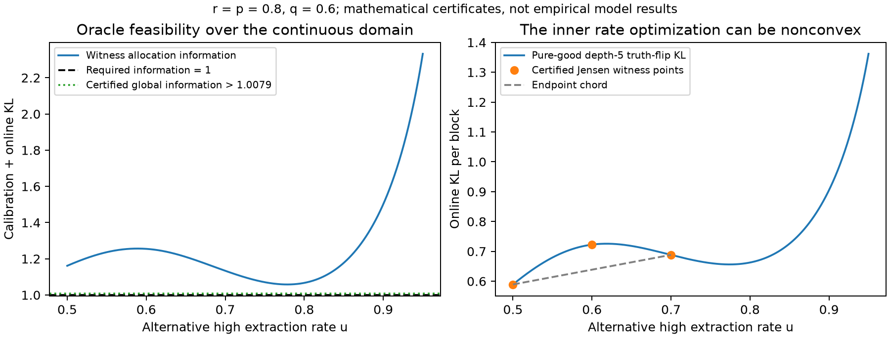

# 未知可靠率与有限校准：本轮理论结果

日期：2026-10-31。

**结论：本轮理论任务完成，GO；一般多读模型的标量共享门槛仍为 OPEN，论文核心创新判断保持 REVISE。**

我们已经把未知连续可靠率 p,q 和有限校准接回持续性来源模型，完成信息下界、正确停止及匹配期望在线成本的证明。更重要的是，得到精确认证的反例：**上一轮在已知可靠率下成立的“零一阶额外成本”，在有限校准下可以重新变成严格正的额外成本。**

主要文件：[完整理论结果](THEORY_RESULTS.md)、[期望成本证明](CONTINUOUS_COST_PROOF.md)、[oracle 与共享判据审计](ORACLE_AND_THRESHOLD_AUDIT.md)。

## 1. 本轮恢复了什么，仍固定了什么

保留上一轮的持续性来源错误：一个来源给出的报告可能一直错误，对它多次读取不能当作独立事实证据。来源可靠率 r 仍已知。

恢复了两项原理论条件：

- 共同的优、劣抽取可靠率 p,q 未知，属于连续参数域，没有已知的正间隔下界。
- 每个可靠率有一条带身份标签的参考流，各有 M 个样本；M/log(1/delta) 趋于有限 alpha。

参考流记录的是“对已知来源报告的抽取是否正确”，不是“该来源的事实是否真实”。高、低参考流身份已知是一项明确信息假设，不能用普通无标签历史对话替代。

oracle 只知道组的优形式 z，仍不知道 p,q，也只获得同样的校准数据。在线成本不包含已获取的参考样本；若每个参考样本成本为 b_cal，总成本应另加 2b_cal M。正确率保证包含参考样本的随机性，不要求每一份具体参考记录条件下都正确。

来源读取仍是预先决定的有限块，允许所有 A/B 混合组合，完成后放弃来源。没有开放重访、块内调整、多事实共享一次访问或未知来源可靠率。

## 2. 已经闭合的理论结果

**第一，得到完整连续参数的信息规划与匹配可达性。** 校准 KL 只计入一次；所有错误事实、类型变化和连续可靠率替代都纳入约束。最优值 K 满足

\[
\inf_\pi E[C_\pi]=K\log(1/\delta)+o(\log(1/\delta)).
\]

这个结论证明的是期望在线成本。不同读取块成本不同，证明专门使用成本越界时刻处理尾概率，没有把“查询次数最优”误写成“成本最优”。

**第二，停止规则可以严格处理未知参数和误导性的校准记录。** 每个来源块按完整类别分布建模，用联合校准与在线 likelihood 的停止规则统一控制错误。不能先假定参考样本足够准确，再直接使用已知参数的停止界。

**第三，原来的重要化简仍然成立。** 即使有混合读取、类型交换和连续替代参数，也只需要检查“翻转一个事实”的替代，再遍历所有组类型模式。这项化简有单独证明。

**第四，保留了正确的一般判据。** 未知形式能否达到 oracle 的一阶成本，取决于 oracle 的完整最优分配集合中，是否存在同时满足全部未知类型替代约束的分配。这个条件适用于多读模型；目前没有证明它总能压缩成只依赖最小组大小的单一公式。

这些是模型内的理想数学结果，使用精确 likelihood 和精确优化。普通网格或局部优化程序不自动继承正确性或最优性保证。

## 3. 最重要的新反例：已知率下成立，有限校准下失效

固定以下参数，没有选择或删去任何混合读取动作：

| 参数 | 值 |
|---|---:|
| 来源可靠率 r | 0.8 |
| 真实优、劣抽取率 p,q | 0.8、0.6 |
| 参数上界 | p≤0.95 |
| 事实数 | 1 |
| 每个来源最大读取数 | 5 |
| 来源访问成本 / 单次读取成本 | 10 / 1 |
| 每条参考流的校准比率 alpha | 1 |
| 可用纯、混合读取动作 | 全部 20 种 |

两种模型的结论不同：

| 信息条件 | 已证明的结果 |
|---|---|
| p,q 已知 | oracle 唯一选择深度 5；上一轮判据大于 1，未知形式没有一阶额外成本 |
| p,q 未知，alpha=1 | 未知形式成本系数 >24.496612；同样不知道 p,q 的已知形式 oracle 成本系数 ≤24.15 |

因此严格推出：

\[
K_{\rm learner}-K_{\rm oracle}>0.346612,
\qquad
\frac{K_{\rm learner}}{K_{\rm oracle}}>1.014352.
\]

这是**保守的上下界证明**，不是声称求出了两个连续问题的精确最优值，也不是有限预算准确率提升。

认证分两部分：

1. 对一个合法的错误事实、交换类型替代，验证全部 20 个动作的对偶不等式，得到学习者下界。
2. 构造成本 24.15 的 oracle 可行分配。将连续可靠率区间划成 900 个小区间，使用精确有理数对数界和全局导数界覆盖每个区间中的所有点，证明它对整个连续替代域可行。

所以这不是“只在 900 个网格点上通过”的结论。代码与证据见 [精确证书](THRESHOLD_FAILURE_CERTIFICATE.json) 和 [复现说明](README.md)。

## 4. 另一个方向也会误判：oracle 的信息必须匹配

当每个来源只读一次、只有一个事实、alpha=0 时，正确的未知率比较满足

\[
K_{\rm learner}=K_{\rm oracle}
=\frac{c+\ell}{\operatorname{kl}(\rho(p),1/2)},
\qquad
\rho(a)=\tfrac12+(2r-1)(a-\tfrac12).
\]

取 r=.8,p=.8,q=.6、c=0、ell=1，共同系数约为 15.0880。但已知率的旧判据约为 .43094，小于 1，会预测存在形式额外成本。

原因是正确的未知率 oracle 也更困难了。这不是学习者绝对效率变高，更不能拿已知 p,q 的强 oracle 与未知 p,q 的另一个模型混比。

两个反例合在一起说明：直接套用已知率门槛会在两个方向误判。

## 5. 哪一部分已经重新接上原 Theorem 1–3

**每个来源只读一次时，修正后的最小共享组定理已经证明。**

在线回答的准确率变成 rho(p)、rho(q)，但离线参考流仍是原始 p,q。这两层必须分开。用正确的两层 likelihood，可以证明：

- oracle 唯一使用优形式，对各事实均匀分配；
- 有限 alpha 下有修正后的最小共享组充要条件；
- alpha=0 时，零一阶额外成本当且仅当只有一个共享组；
- 对单事实，任何有限正 alpha 都产生严格正的形式额外成本，而 alpha=0 时为零。

最后一条不意味着两个成本函数不连续，也不意味着额外成本随 alpha 单调上升。

**每个来源允许多读时，目前只能保留完整变分判据。** 已知率下的支配论证使用依赖 p,q 的随机变换；p,q 未知时，它不能同时变换所有替代模型。因此尚不能证明一般 oracle 只用纯优形式，也不能反过来说混合形式必然有优势。

## 6. 数值求解也出现了实质性变化

分配变量的外层问题仍是凸的，但内层可靠率优化可以非凸。对同一深度 5 的例子，精确验证了：

\[
f(.6)-[f(.5)+f(.7)]/2>0.083885,
\]

其中 f(u) 是真实正事实块与可靠率为 u 的反事实块之间的 KL。这直接排除了把原来的 Bernoulli 闭式投影当作通用精确求解器。

保留了 alpha=0、.1、1、5、20、100 的六个说明性网格诊断，共 12 个网格 LP。它们明确标记为连续问题的松弛。尤其 alpha=20 或 100 时两个网格值相等，**不能据此声称连续问题已经零额外成本**。

核心反例由单独的精确证书支撑，没有依赖局部优化器正确性。

## 7. 新颖性与论文判断

本轮核查了五个核心近邻和一个通用 GLR 辅助来源。离线与在线信息共同进入 KL 下界，已有 [Agrawal 等 2023](https://arxiv.org/abs/2306.09048) 的直接先例；类别数据的有效顺序检验也有 [Lindon–Malek 2022](https://papers.nips.cc/paper_files/paper/2022/file/12f3bd5d2b7d93eadc1bf508a0872dc2-Paper-Conference.pdf) 等基础。

因此候选贡献应集中在：**持续性来源错误、来源成本、未知抽取可靠率与有限校准如何共同改变共享门槛，以及已知率结论为什么会失效。** 通用 KL 规划与混合检验工具应明确归因，不能包装成全新框架。

当前可以写成理论章节的内容已有：受控模型、正确的最优成本刻画、已知率与未知率的区分、修正的一读定理、认证的多读反例。一般多读共享阈值、真实 Web 条件验证和优先权仍未完成，所以不能据此判断整篇论文已经可投。

## 8. 交付状态与下一步

| 工作 | 状态 |
|---|---|
| 连续未知率联合信息规划与期望成本证明 | 完成并经协作者复核 |
| 完整块分布的有效停止规则 | 完成 |
| 任意混合块的单事实翻转化简 | 完成 |
| 一读菜单的修正共享门槛 | 完成 |
| 已知率门槛双向误判的例子 | 完成，两个精确证书 |
| 多读内层非凸反例 | 完成，精确认证 |
| 一般多读 oracle 的结构 | 未解决 |
| 一般多读的标量共享门槛 | 未解决 |
| 实际 Web / Qwen 有效性 | 本轮未测试 |

本轮继续使用 academic-research-suite 流程；证明审查共享上下文和模型家族，不是盲审、跨模型验证或机器形式化证明。原理论输入与两个旧快照均保留。没有模型调用、训练、随机 benchmark 世界或确认实验。

**建议下一步只推进多读 oracle 的结构。** 先证明或反驳它是否需要混合形式或多个深度，再判断最小组大小是否仍足以决定零额外成本。内层已经存在非凸性，所以新的数值分离必须配连续域证书，不能靠局部求解器的输出决定理论方向。暂时继续保留固定块和已知 r，避免同时开放重访或来源相关性。
