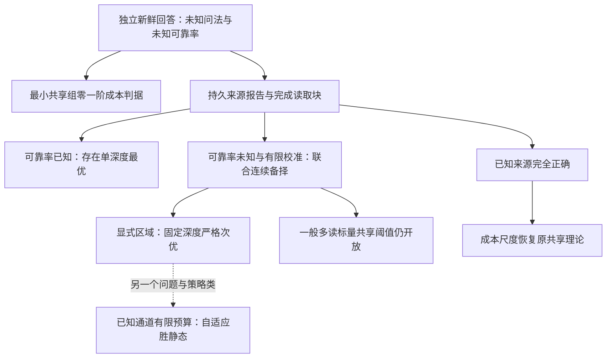

# 现有理论总表：从共享问法到 Web 证据获取

日期：2026-11-01。用途：对当前仓库理论作一次有边界的综合，不改写旧理论，不给已有证明追加外部认证。下列“已证明”指已有书面证明/证书所支持的模型内结论；本轮没有重做所有证明，也没有新的独立专家审阅。

## 1. 三种模型先分开

| 模型 | 隐变量与观测 | 已知与未知 | 策略和目标 |
|---|---|---|---|
| I：原始独立回答 | 真值 θ_j，组内最佳形式 z_g，每次获得关于 θ_j 的新鲜回答 | p,q,z,θ 未知；分组已知；两条有标签参考流 | 逐次选择事实/问法，恢复全部 θ，最小化期望在线查询数 |
| B：Web 完成块 | θ_j→持久来源报告 V_ij→抽取结果 Y_ijmt | 来源正确率 r 已知；p,q 可知或未知，分版本；provenance 声明已给定 | 每个新根只服务一事实；预定 A/B 读取次数，完成后丢弃；跨块自适应；最小化期望在线成本 |
| F：W2a 有限预算 | 单事实、持久根报告、同根副本、独立读取噪声 | r,a 已知，单一读取通道；根身份已声明 | 允许逐次动作、停止和重访；每条路径硬预算；比较 Bayes 错误率 |

B 的一般未知率版本保留 1/2≤q<p≤1−η，固定有限深度上限、维度与菜单。I/B 的渐近结论在每个固定实例上令 δ→0，非增长维度/消失间隔的统一保证。F 不是 B 的直接方法实现。

α=lim Mδ/log(1/δ)，Mδ 是每条参考流的长度，总计 2Mδ。α=0 包含有参考数据但规模为 o(log(1/δ)) 的情况。比较 oracle 只额外知道 z，保留同样未知的 p,q 与参考数据；额外揭示 p,q 必须另列为不同信息条件。

## 2. 已有结果清单

| ID | 理论问题与核心结果 | 已有依据 | Web 解释 / 正文建议 |
|---|---|---|---|
| I1 | 联合信息规划给出 K，理想策略达到 Eτ=K log(1/δ)+o(log(1/δ))；共同未知 p,q 造成跨组备择耦合 | 原笔记 Theorem 1、期望时间补充及审计 | 学习接口可靠性与恢复答案须联合处理；作为数学基础，工具本身已有先例 |
| I2 | 已知最佳形式但未知率的 oracle：唯一的一阶分配为每事实均匀使用优形式，K_or=d a_α，a_α 由标量方程确定 | 原笔记 Theorem 2 | 提供信息匹配的比较基准；不能把 oracle 写成知道真值或 p,q |
| I3 | K_S,α=K_or,α 当且仅当 Γ_kmin(α)≥1；最小组决定额外一阶成本是否为零，整分组仍影响正差大小 | 原笔记 Theorem 3 | 原研究最清晰的结构贡献；Web 一般多读时不能直接照搬 |
| I4 | α=0 时零一阶额外成本 iff G=1；共享合并不增加成本；α→∞ 恢复已知率公式 | 原笔记推论 3.1–3.3 | 解释何时任务自身可提供足够可靠性信息；不是无样本成本或任意联合极限 |
| I5 | 更多校准可使“知道最佳形式”的价值先升后降，存在精确认证实例；两方成本各自不增 | 原笔记 §7，数值界与有理对数证书 | 区分总体变容易与信息差价值；短文中的次要结果 |
| I6 | 完美类型询问将额外成本压至≤G；有限可靠类型询问可有用；相同通道的已知答案检查不改善一阶系数 | 原笔记 §8 | 限制复杂询问算法的适用场景；未经验证的自报不满足已知可靠率假设 |
| W1 | 有限根证据饱和，KL≤S·kl(r,1−r)；同源反复读不能消除来源错误；单一事实后验与次数不足以决定最优下一动作 | Web 初始结果中的 DPI、误差界和精确状态反例 | 区分“读对陈述”与“陈述为真”；饱和本身是标准工具，不作主创新 |
| W2 | 已知 r,p,q 时 oracle 只需纯优形式，存在单深度最优解；成本最优深度集合 M(c)=argmax A_L/(c+ℓL) | 已知率成本理论 | 可靠率已知时，重读与新源的成本权衡可简化为选深度 |
| W3 | 已知率：零额外一阶成本 iff max_{L∈M(c)}[V_L+(kmin−1)U_L]/A_L≥1；并列深度必须检查全最优集合 | 已知率成本理论与对抗审计 | 来源成本通过最优深度改变共享需求；Γ 不普遍随深度单调，不能概括为越贵越容易 |
| W4 | 未知率＋有限校准：完整块类别似然、联合 KL 规划、正确停止与匹配期望在线成本；一事实翻转化简成立 | 连续成本证明与未知校准报告 | 将原可靠性学习接回 Web 来源层；通用 KL/GLR 思想不是独立新贡献 |
| W5 | 已知率共享判据在未知率下可以双向误判；r=.8,p=.8,q=.6,α=1,c=10,ℓ=1,Lmax=5 时 learner−oracle>0.346612 | 连续备择域认证反例 | 把“已测得平均准确率”当已知通道会改变结论；精确最优值未被该上下界求出 |
| W6 | α=0 或 q=1/2 时 oracle 全部最优分配只用优形式；α=0 多读下零额外成本 iff G=1；一般正校准纯优结构仍开放 | Oracle 结构定理与审计 | 恢复原理论的一个重要边界；有限校准一般最小组标量公式尚未解决 |
| W7 | 一事实、有限校准：每个最优分配必须使用至少两种深度；固定深度仍允许所有 A/B 组合；明确五维区域内相对成本系数优势≥5/103 | 混合深度点证书与区域定理 | 推荐候选主贡献：即使已知最佳问法，未知可靠程度仍可能破坏固定深度最优性 |
| W8 | 若来源已知完全正确 r=1，则 K=(ℓ+c/N)T；固定 L 的 K_L=(ℓ+c/L)T；c>0 时所有最优一阶分配只用最大深度 N | 完美来源控制解析证明 | 严格连接原理论与 Web 扩展，并解释为何持久来源错误重要 |
| F1 | 已知 r,a、硬预算：冻结自适应策略在一非退化区域优于全部静态深度分配及随机解码，至少0.572个百分点 | W2a 精确中心证书＋耦合区域证明 | 另一种有限预算自适应分离；独立于 W7，不是未知率学习实验 |
| F2 | 同源副本在同通道同费用下等价；URL-iid 后验会过度自信；持久读取错误与 iid 抽取有不同极限 | W2a 解析机制与控制 | 建模诊断；不能把错误置信度对照变成公平准确率基线 |

## 3. 候选主定理 W7，保留完整量词

固定 d=1、Lmax=6、η=1/40。oracle 已知最佳格式，但不知道 θ,p,q；r 在每个实例中已知。允许全部 27 种完成块，块内不决策，完成后不重访。两路有标签参考数据校准的是对已知报告 V 的抽取正确性。

在

\[
r,q\in[.599975,.600025],\quad p\in[.949975,.950025],\quad
\alpha\in[.95,1.20],\quad c/\ell\in[.5,1.5]
\]

内，完整菜单系数及每一固定深度系数满足

\[
K_{\rm or}\le16c+18\ell,
\qquad
K_L\ge16c+18\ell+15\ell/7,\quad L=1,\ldots,6.
\]

因此全部最优**一阶分配**的支撑包含至少两种深度；相对每个固定深度的在线成本系数降低至少 5/103≈4.85%。可行见证仅使用优形式，x_(1,0)=14、x_(2,0)=2。它证明完整问题的上界，不证明全局最优恰好纯优、恰好两深度，也不是实际只运行16个来源就能达到任意 δ。

三维可靠率区间很窄；非空内部排除了孤立精调点，不能据此写“广泛参数下成立”。正文宜同时给更直观的中心机制对照，并把区域说成显式充分内盒。

混合深度是分配支撑的性质，观测自适应是动作依赖历史的性质。W7不证明所有预先安排的混合深度方案都次优；F1才比较全部静态深度分配，二者不能互换。

## 4. 最有解释力的机制对照

固定 p=.95,q=.6,d=1,Lmax=6,c=ℓ=1；比较对象都知道最佳形式。

| 来源条件 | 抽取率信息 | 结论 |
|---|---|---|
| r=1，且该条件对整个备择域已知 | p,q 未知，α=1 | 最优一阶分配只用深度6 |
| r=.6 | p,q 额外揭示 | 中心实例唯一最优深度1；一般已知率情形存在单深度最优解 |
| r=.6 | p,q 未知，α=1 | 每个最优分配必须混合深度；点证书分离至少17.68%，区域统一界为4.85% |

这是模型信息条件的机制分离，不能作为三种算法在相同信息条件下的性能排名。去掉任一关键因素可消除这里的强制混合，不表示这两个因素在全部参数下都足以产生混合。

## 5. 两个不同的“共享”

1. **格式共享组 g**：若干事实/抽取任务共享同一个未知最佳形式 z_g。这是给定的统计结构假设。
2. **provenance 根 i**：同一份持久报告及其副本共享 V_ij。这造成证据依赖，不等于它们共享最佳形式。

不能按同域名、同 URL 前缀或相同组标签自动识别任意一种结构。主定理只需一事实、最佳形式已知，故核心深度结果不依赖实证发现共享问法；原最小组定理则依赖格式共享假设。这是两者最关键的取舍。

## 6. 连接关系

虚线是概念关联，不表示定理蕴含、方法实现或实验验证。

## 7. 已有理论与可执行方法的边界

原理论与连续 Web 理论的可达性均针对有明确计算契约的理想策略。机器优化器的请求容差、固定积分节点或浮点残差不自动满足实际误差消失条件。

Phase2d 的严格停止有声明范围内的算术证书；Phase2e 完成了32个 Exact 开发世界、288条轨迹，但最终判断仍为 REVISE、未执行独立确认。其近似后验与贪心 IG 分配没有已证明跟踪最优 KL 集。不能用这些开发成绩给 Web 完成块模型追加渐近最优性。

本轮仅对已有结论做整理，不重跑上述算法或证书，不更新任何旧报告。

## 8. 依据索引

- [原始 Theory Note](../../Theory_Note.md)，[期望时间补充](../../experiments/phase2b_alignment_20261031/PROOF_ADDENDUM.md)，[证明到代码审计](../../experiments/phase2c_strong_baseline_20261031/PROOF_AUDIT.md)。
- [Web 初始理论](../web_native_theory_20261031/WEB_THEORY_RESULTS.md)。
- [已知率成本与共享](../web_cost_sharing_20261031/THEORY_RESULTS.md)。
- [未知校准理论](../web_unknown_calibration_20261031/THEORY_RESULTS.md)，[期望成本证明](../web_unknown_calibration_20261031/CONTINUOUS_COST_PROOF.md)。
- [Oracle 结构报告](../web_oracle_structure_20261031/RESEARCH_REPORT_CN.md)，[深度结构审计](../web_oracle_structure_20261031/DEPTH_STRUCTURE_AUDIT.md)。
- [区域定理](../web_depth_region_20261101/REGION_THEOREM.md)，[完美来源控制](../web_perfect_source_control_20261101/PERFECT_SOURCE_THEOREM.md)。
- [W2a 报告](../../experiments/w2a_controlled_provenance_20261101/REPORT_ZH.md)。
- [Phase2e 当前最终判断](/home/gaoym/When_Learning_How_to_Ask_phase2e/experiments/phase2e_type_evidence_20261031/FINAL_RESEARCH_DECISION.md)。
